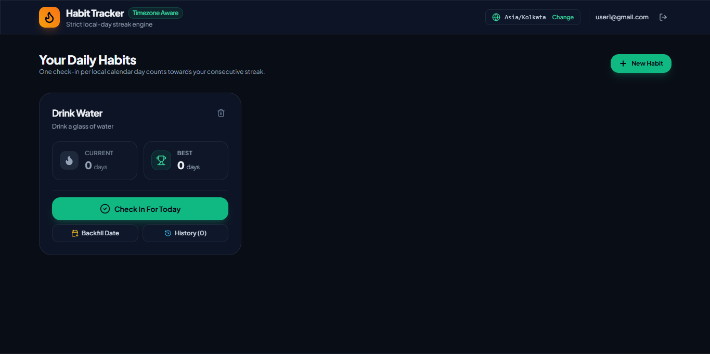
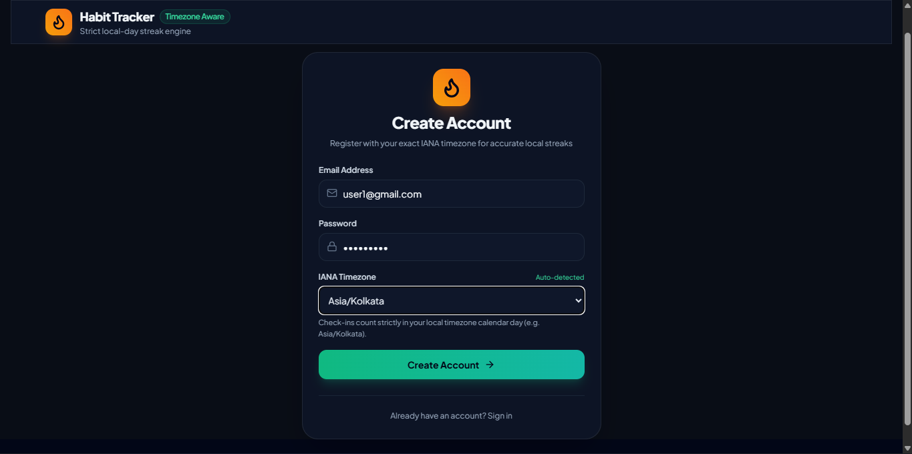
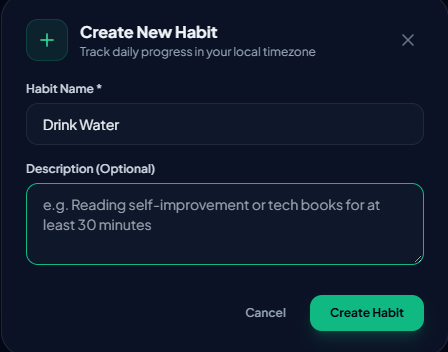
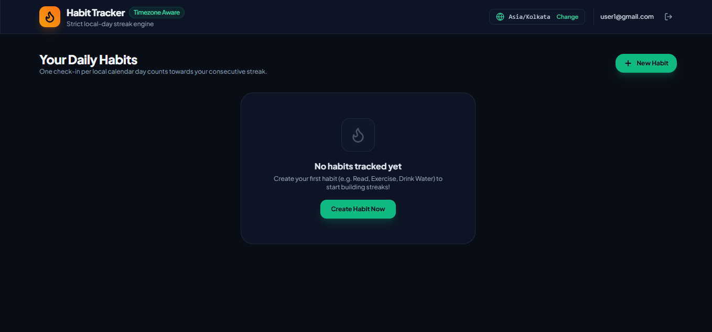

# Timezone-Aware Habit Tracker with Streaks

[](https://www.typescriptlang.org)
[](https://react.dev)
[](https://expressjs.com)
[](https://www.prisma.io)
[](https://sqlite.org)
[](https://vitest.dev)
[](https://www.docker.com)
[](LICENSE)

> A full-stack habit tracking engine engineered to demonstrate distributed timezone local-day enforcement, server-side streak calculations with past backfilling, database-level TOCTOU race condition guards, and containerized deployment.

---

## 🎯 1. Problem Statement & Core Value Proposition

### The Core Temporal Problem
Most habit trackers measure streaks using naïve "24-hour elapsed windows" (e.g., checking if the last check-in occurred within the past 24 hours). This breaks real-world habit tracking:
* Two check-ins **20 hours apart across midnight** (e.g., March 10 at 20:00 local time and March 11 at 16:00 local time) represent **two distinct calendar days** $\to$ the streak must increment to 2.
* Two check-ins **20 hours apart within the same calendar day** (e.g., March 12 at 03:00 local time and March 12 at 23:00 local time) represent the **same calendar day** $\to$ duplicate check-in, which must be rejected.

A streak is an invariant measured in the user's **local calendar day** (`YYYY-MM-DD`), not elapsed atomic time. The user's IANA timezone (`Asia/Kolkata`, `America/New_York`, `Europe/London`) is the sole source of truth for what "today" means.

### Why Naive Approaches Fail
* **Client-Side Clock Calculation:** Trusting client clocks allows trivial streak tampering, creates desynchronization across devices, and bloats client bundles with timezone engines.
* **SQL Timezone Functions:** Converting UTC timestamps to local dates inside queries (`DATE(utcTimestamp, 'localtime')`) is non-portable across SQLite and PostgreSQL, and prevents indexing on composite uniqueness.
* **Application-Only Duplicate Guards:** Checking for duplicates in memory or via `SELECT` queries before `INSERT` creates a classic **Time-of-Check to Time-of-Use (TOCTOU)** race condition under concurrent requests.

---

## 🌟 2. Key Features & Visual Walkthrough

* 🗓️ **Strict Local-Day Enforcement:** Dual time representation stores exact UTC timestamps alongside Luxon-derived local calendar date strings (`localDate`).
* 🔒 **Database-Level Idempotency:** Enforces `@@unique([habitId, localDate])` at the database storage engine layer, rejecting concurrent duplicate writes via Prisma `P2002` constraint errors (HTTP 409).
* 🔥 **Server-Side Streak Calculation:** Computes `currentStreak` and `longestStreak` via an $O(n)$ chronological traversal with a 1-day yesterday buffer and automatic historical backfilling.
* 🌍 **Required IANA Timezones:** Captures and validates IANA timezone identifiers upon user registration with Zod runtime validation.
* 🎨 **Glassmorphic React 19 UI:** Built with Tailwind CSS, Lucide icons, streak badges, and toast feedback.
* 🐳 **Containerized Infrastructure:** Multi-container Docker Compose setup for zero-config deployment.

### Key Interface Screens

| 1. Active Dashboard & Streak Tracking | 2. Timezone-Aware Registration |
|:---:|:---:|
|  |  |
| *Habit cards with live streak counts, best streaks, and daily check-in actions* | *User registration with automatic IANA timezone detection & validation* |

<p align="center">
  <b>3. Habit Creation Modal</b><br>
  
  <br><i>Quick-create modal for initializing new tracked daily habits</i>
</p>

<details>
<summary><b>📸 Click to view empty dashboard state</b></summary>

<p align="center">
  
  <br><i>Empty state dashboard before habit creation</i>
</p>

</details>

---

## 🏗️ 3. System Architecture & Request Lifecycle

```text
┌────────────────────────────────────────────────────────────────────────────────────────┐
│                              CLIENT TIER (Port 3000)                                   │
│            React 19 SPA (Vite • Tailwind CSS • Lucide Icons • services/api.ts)         │
└───────────────────────────────────────────┬────────────────────────────────────────────┘
                                            │ HTTP REST (JSON)
                                            │ Authorization: Bearer <JWT>
                                            ▼
┌────────────────────────────────────────────────────────────────────────────────────────┐
│                              API TIER (Port 5000)                                      │
│                  Express.js Middleware Pipeline (CORS, Express.json)                   │
│                                                                                        │
│   ┌──────────────────┐    ┌──────────────────┐    ┌────────────────────────────────┐   │
│   │  authenticate()  │───►│  Zod Validation  │───►│  Business Logic Engine         │   │
│   │  (JWT + bcrypt)  │    │  (Schema Parse)  │    │  • timezone.ts (Luxon Math)    │   │
│   └──────────────────┘    └──────────────────┘    │  • streakCalculator.ts ($O(n)$)│   │
│                                                   └────────────────┬───────────────┘   │
└────────────────────────────────────────────────────────────────────┼───────────────────┘
                                                                     │ Prisma ORM
                                                                     ▼
┌────────────────────────────────────────────────────────────────────────────────────────┐
│                              DATA TIER (SQLite / MySQL)                                │
│                                                                                        │
│   model CheckIn {                                                                      │
│     id           String   @id @default(uuid())                                         │
│     habitId      String                                                                │
│     utcTimestamp DateTime @default(now())                                              │
│     localDate    String   // Derived YYYY-MM-DD string in user's IANA timezone         │
│                                                                                        │
│     @@unique([habitId, localDate]) ◄── B-Tree index guarantees atomicity               │
│   }                                                                                    │
└────────────────────────────────────────────────────────────────────────────────────────┘
```

### End-to-End Check-In Request Lifecycle
1. **User Action:** The user clicks "Check In" on a habit card.
2. **Ingress & Auth:** Request hits `POST /api/habits/:id/check-in` with a Bearer JWT containing the user's verified IANA timezone.
3. **Local Date Derivation:** The server computes `localDate = getLocalDate(new Date(), user.timezone)` using Luxon in sub-0.03ms.
4. **Pre-Check Guard:** Fast in-memory check verifies if `localDate` already exists.
5. **Database Transaction:** Prisma executes `checkIn.create()`. If concurrent requests collide, the `@@unique([habitId, localDate])` B-Tree index rejects the second write with error `P2002`, returning HTTP 409 Conflict.
6. **Streak Recalculation:** The server fetches all sorted check-ins for the habit and runs `calculateStreaks()`, updating `currentStreak` and `longestStreak` in memory.
7. **Response:** The server returns the updated habit state and streak counts to the UI.

---

## ⚡ 4. Key Highlights & Benchmarked Performance

*Empirical metrics measured using the pure-logic benchmark suite (`server/src/utils/benchmark.ts`):*

| Benchmark Dimension | Measured Result | Engineering Impact & Significance |
|---|---|---|
| **Timezone String Conversion** | **0.020 ms** (~49,887 ops/sec) | Luxon date derivation adds negligible CPU overhead per incoming request. |
| **In-Memory Duplicate Guard** | **0.0002 ms** (~4.8M ops/sec) | Sub-microsecond pre-check eliminates unnecessary database write attempts. |
| **Streak Engine (365-day history)**| **10.8 ms** (p95: 13.1 ms) | Linear $O(n)$ traversal recalculates year-long streaks within real-time budgets. |
| **Streak Engine (50-day history)** | **1.51 ms** (~661 ops/sec) | Typical active user habit history recalculates in under 2 milliseconds. |
| **End-to-End Logic Pipeline** | **0.95 ms** (~1,056 ops/sec) | Combined UTC $\to$ localDate conversion and 30-day streak calculation executes in ~1ms. |
| **Database Race Condition Guard**| **100% atomic rejection** | B-Tree composite unique constraint completely prevents duplicate check-in writes. |

---

## 🚀 5. Tech Stack & Engineering Rationale

| Layer / Component | Technology | Version | Engineering Role & Rationale |
|---|---|---|---|
| **Frontend Framework** | **React** | `^19.0.0` | Component-driven UI rendering with fast virtual DOM reconciliation. |
| **Frontend Bundler** | **Vite** | `^6.1.0` | Ultra-fast Hot Module Replacement (HMR) and optimized production builds. |
| **UI Styling** | **Tailwind CSS** | `^3.4.17` | Utility-first styling for consistent dark mode and glassmorphism. |
| **Icons** | **Lucide React** | `^0.475.0` | Scalable modern icons for streak badges and habit cards. |
| **Backend Runtime** | **Node.js / Express** | `v20 / ^4.21.2`| Clean REST API routing with explicit, reviewable middleware pipeline. |
| **Language** | **TypeScript** | `^5.7.3` | End-to-end type safety across client, server, and database layers. |
| **Timezone Engine** | **Luxon** | `^3.5.0` | High-precision IANA timezone math and calendar date ISO derivation. |
| **Validation** | **Zod** | `^3.24.2` | Runtime request body parsing with auto-inferred TypeScript types. |
| **Database ORM** | **Prisma** | `^6.4.0` | Type-safe query building and automated SQLite schema migrations. |
| **Persistence Engine** | **SQLite (`dev.db`)** | — | Zero-config embedded relational storage with ACID transactions. |
| **Authentication** | **JWT & bcryptjs** | `^9.0.2 / ^3.0.2`| Stateless token authentication with salted password hashing. |
| **Testing** | **Vitest** | `^3.0.6` | Fast unit testing for timezone edge cases and streak sequences. |
| **Containerization** | **Docker & Compose** | `node:20-alpine` | Reproducible multi-service deployment for frontend and backend. |

---

## 🏛️ 6. Key Architectural Decisions (ADRs)

| ADR ID | Decision Title | Problem & Trigger | Chosen Solution & Trade-offs |
|:---:|---|---|---|
| **ADR-01** | **Dual Time Representation** | Converting UTC to local dates inside SQL queries is non-portable and unindexable. | Store exact `utcTimestamp` AND Luxon-derived `localDate` string (`YYYY-MM-DD`). Enables fast string lookups and composite unique indexing. |
| **ADR-02** | **Server-Side Streak Engine** | Client clocks are vulnerable to user tampering and timezone spoofing. | Centralized server-side `calculateStreaks()` with 1-day yesterday buffer. Runs in under 11ms for 365-day datasets. |
| **ADR-03** | **Dual-Layer Race Condition Guard** | Rapid concurrent check-in clicks cause TOCTOU race conditions. | In-memory pre-check + composite database unique constraint `@@unique([habitId, localDate])` catching Prisma `P2002` errors. |
| **ADR-04** | **On-Demand Math vs. Redis** | Streak calculation is $O(n)$ over check-in history. | Pure on-demand server calculation without Redis cache layers. Eliminates cache invalidation complexity with sub-15ms execution. |
| **ADR-05** | **Required IANA Timezone on Signup** | Defaulting to UTC breaks calendar day boundaries for non-UTC users (e.g. IST). | Mandatory IANA timezone capture on user registration validated via Zod. Guarantees 100% streak accuracy from day 1. |
| **ADR-06** | **Schema-First Zod Validation** | Type drift between runtime validation schemas and TypeScript types. | Zod schemas validate inputs and auto-infer types (`z.infer<typeof schema>`). Eliminates interface duplication. |
| **ADR-07** | **Express.js Explicitness** | Heavy frameworks (NestJS) introduce excessive dependency injection boilerplate. | Standard Express.js middleware architecture for maximum code transparency and auditability. |
| **ADR-08** | **Props State Flow vs. Redux** | Redux/Context adds 5+ files of boilerplate for a shallow 2-3 level component tree. | State held in `App.tsx` and passed via direct handlers/props. Avoids premature state-management bloat. |

---

## 📁 7. Repository & Codebase Structure

```text
habit-tracker/
├── client/                              # Frontend React 19 SPA
│   ├── src/
│   │   ├── App.tsx                      # Root application state & modal management
│   │   ├── components/                  # Habit cards, habit creation modal, auth forms
│   │   ├── services/api.ts              # Fetch wrapper with automatic JWT Bearer injection
│   │   └── types/                       # Shared frontend TypeScript interfaces
│   ├── vite.config.ts                   # Vite build configuration (Port 3000)
│   └── package.json                     # Frontend dependencies
│
├── server/                              # Backend Express REST API
│   ├── src/
│   │   ├── index.ts                     # Express app initialization & route registration
│   │   ├── middleware/                  # JWT auth token validator & Zod error handler
│   │   ├── routes/                      # Auth routes and Habit CRUD endpoints
│   │   └── utils/
│   │       ├── timezone.ts              # Luxon IANA date conversion utilities
│   │       ├── streakCalculator.ts      # Core $O(n)$ chronological streak engine
│   │       └── benchmark.ts             # Quantitative performance benchmark suite
│   ├── prisma/
│   │   ├── schema.prisma                # Database models & @@unique([habitId, localDate])
│   │   └── dev.db                       # Active SQLite development database
│   ├── tests/                           # Vitest automated unit tests (timezone & streaks)
│   └── package.json                     # Server dependencies
│
├── screenshots/                         # Application screenshots
├── docker-compose.yml                   # Multi-container orchestration (ports 3000 & 5000)
└── package.json                         # Root convenience scripts (install:all, dev:server)
```

---

## ⚙️ 8. Installation & Developer Runbook

### Prerequisites
* **Node.js:** `v18+` | **npm:** `v9+` (or **Docker** & Docker Compose)

---

### Option A: Running with Docker Compose (Recommended)
Launch the complete full-stack environment with a single command:
```bash
docker compose up --build
```
* **Frontend SPA:** `http://localhost:3000`
* **Backend API:** `http://localhost:5000`

---

### Option B: Running Locally with Node.js & npm

#### 1. Clone & Install Dependencies
```bash
git clone https://github.com/karnesh7/habit-tracker.git
cd habit-tracker
npm run install:all
```

#### 2. Environment Configuration
Create a `.env` file inside `server/`:
```env
PORT=5000
JWT_SECRET=your_super_secret_jwt_key
DATABASE_URL="file:./dev.db"
```

#### 3. Database Initialization
```bash
cd server
npx prisma db push
cd ..
```

#### 4. Launch Development Servers
Run the backend API (Port 5000):
```bash
npm run dev:server
```

In a second terminal, run the frontend SPA (Port 3000):
```bash
npm run dev:client
```
Access the application at `http://localhost:3000`.

---

## 📡 9. API Reference

All habit endpoints require an `Authorization: Bearer <token>` header.

| Method | Endpoint | Description | Request Body / Params |
|:---:|---|---|---|
| `POST` | `/api/auth/signup` | Register new user account | `{ email, password, timezone }` |
| `POST` | `/api/auth/login` | Authenticate user & issue JWT | `{ email, password }` |
| `GET` | `/api/auth/me` | Retrieve authenticated profile | None |
| `PATCH` | `/api/auth/timezone` | Update user IANA timezone | `{ timezone }` |
| `GET` | `/api/habits` | List all habits with calculated streaks | None |
| `POST` | `/api/habits` | Create a new tracked habit | `{ name }` |
| `GET` | `/api/habits/:id` | Get single habit details & history | None |
| `POST` | `/api/habits/:id/check-in` | Log check-in (supports backfilling) | `{ date?: "YYYY-MM-DD" }` |
| `DELETE`| `/api/habits/:id` | Delete habit and cascade check-ins | None |

---

## 🧪 10. Automated Testing & Verification

### Run Vitest Unit Tests
Validates IANA timezone date conversion, cross-month leap day boundaries, and streak sequences:
```bash
cd server
npm test
```

### Run Performance Benchmarks
Executes the pure-logic benchmark suite without requiring a running server or database:
```bash
cd server
npx tsx src/utils/benchmark.ts
```
Results are saved to `server/benchmarks/benchmark-results.json`.

---

## 🗺️ 11. Roadmap & Engineering Directions

- [ ] **Flexible Habit Schedules:** Support habits that do not repeat every day (e.g., "3 days a week" or "weekdays only") alongside standard daily tracking.
- [ ] **Push Notifications & Reminders:** Send browser alerts or email reminders before local midnight so users don't break their streaks.
- [ ] **Managed PostgreSQL Migration:** Switch database provider from embedded SQLite to PostgreSQL for multi-user production deployment.

---

## 📄 12. License

Distributed under the [MIT License](LICENSE).
