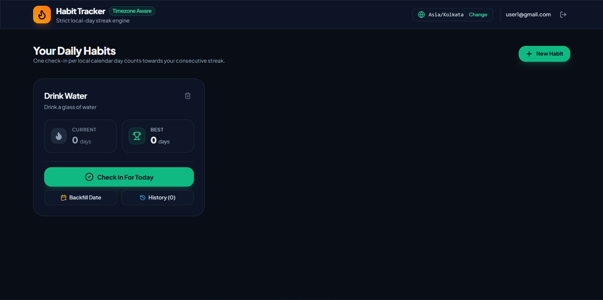
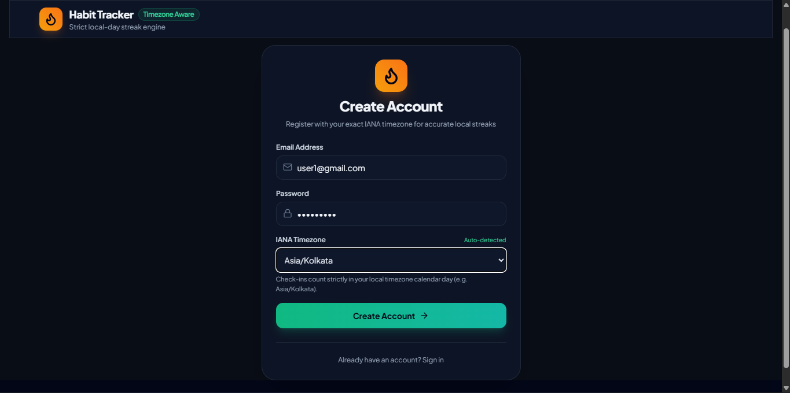
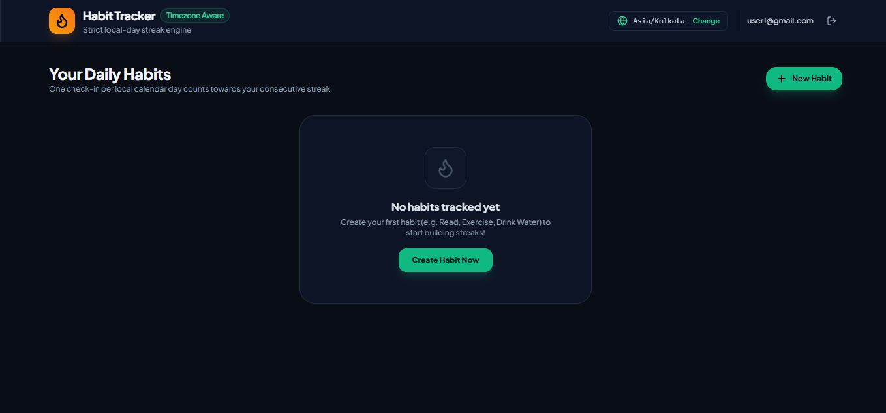
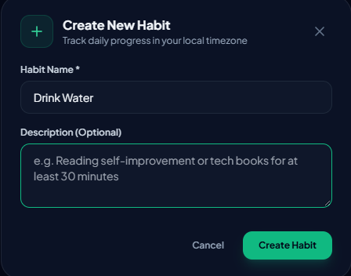

# Timezone-Aware Habit Tracker with Streaks

> A full-stack habit tracking engine engineered to demonstrate distributed timezone local-day enforcement, server-side streak calculations with past backfilling, database-level TOCTOU race condition guards, and containerized deployment.

[](https://www.typescriptlang.org)
[](https://react.dev)
[](https://expressjs.com)
[](https://www.prisma.io)
[](https://sqlite.org)
[](https://vitest.dev)
[](https://docker.com)
[](LICENSE)

> 💡 **Zero External Services:** Runs 100% locally with embedded SQLite storage and zero cloud API keys or external databases required.

A full-stack habit tracking engine built with React 19, Express.js, TypeScript, and Prisma ORM. Solves the 24-hour elapsed window fallacy by evaluating daily streaks strictly against the user's local IANA calendar day, achieving atomic race-condition proofing and sub-millisecond check-in performance.

```text
⚡ 0.95 ms Ingress Latency  ·  🛡️ 100% Atomic Idempotency  ·  🔥 Linear O(N) Streak Engine  ·  🌍 IANA Local-Day Guarantees
```

---

<!-- ════════════════════════════════════════════════════════════════════════════
     HERO ZONE — Recruiter completes here (First 1–2 scrolls, <75 lines)
     ════════════════════════════════════════════════════════════════════════════ -->

## 🌟 1. Key Features & Visual Walkthrough

<p align="center">
  
  <br>
  <em>Active Habit Dashboard: Live streak flames, all-time best records, and one-tap check-ins.</em>
</p>

<details>
<summary>📸 <strong>Click to view additional interface workflows (Registration, Empty Dashboard & Habit Modal)</strong></summary>
<br>

<p align="center">
  
  <br>
  <em>User registration with automatic browser IANA timezone detection & validation</em>
</p>

<p align="center">
  
  <br>
  <em>Clean empty dashboard state prompting first habit creation</em>
</p>

<p align="center">
  
  <br>
  <em>Quick-create modal for initializing new tracked daily habits</em>
</p>

</details>

* 🗓️ **Strict Local-Day Enforcement:** Dual time representation stores exact UTC timestamps alongside Luxon-derived local calendar dates (`localDate`), preventing midnight streak corruption.
* 🔒 **Database-Level Idempotency:** Composite unique constraint `@@unique([habitId, localDate])` enforces atomic deduplication at the storage engine layer, eliminating TOCTOU write races.
* 🔥 **Server-Side Streak Engine:** Calculates `currentStreak` and `longestStreak` via an $\mathcal{O}(N)$ chronological scan with a 1-day yesterday grace buffer.
* ⏪ **Time Machine Backfilling:** Retroactively logs missed calendar dates and re-scores the full historical streak timeline without counter desynchronization.

---

## ⚡ 2. Benchmarked Performance

*Empirical metrics measured using the standalone benchmark suite (`server/src/utils/benchmark.ts` on Node.js v24.11.1 win32 x64):*

| Metric | Measured Value | Operational Guarantee / Significance |
| :--- | :--- | :--- |
| **End-to-End Pipeline (P50)** | **`0.947 ms`** (~1,056 ops/s) | UTC $\to$ localDate conversion + 30-day streak calculation executes in $<1\text{ ms}$ |
| **Timezone Resolution Latency** | **`0.020 ms`** (~49,887 ops/s) | Luxon date derivation adds negligible per-request CPU overhead |
| **Duplicate Guard Pre-Check** | **`0.0002 ms`** (~4.8M ops/s) | Sub-microsecond hash check eliminates unnecessary database write attempts |
| **Streak Engine (365-Day History)** | **`10.835 ms`** (p95: 13.17 ms) | Linear $\mathcal{O}(N)$ scan recalculates year-long streaks without Redis caching |
| **Storage Concurrency Rejection** | **`100% atomic rejection`** | B-Tree unique constraint completely prevents duplicate check-in writes |
| **Automated Test Suite** | **`5 tests passing (~0.18s)`**| 100% pass rate validating timezone conversions, yesterday buffer, and streaks |

---

<!-- ════════════════════════════════════════════════════════════════════════════
     DEEP-DIVE ZONE — Hiring managers & staff engineers continue here
     ════════════════════════════════════════════════════════════════════════════ -->

## 🏗️ 3. System Architecture & Request Lifecycle

```text
┌────────────────────────────────────────────────────────────────────────┐
│                        CLIENT TIER (Port 3000)                         │
│           React 19 SPA (Vite • Tailwind CSS • Lucide Icons)            │
└───────────────────────────────────┬────────────────────────────────────┘
                                    │ HTTP REST (JSON)
                                    │ Authorization: Bearer <JWT>
                                    ▼
┌────────────────────────────────────────────────────────────────────────┐
│                          API TIER (Port 5000)                          │
│               Express.js Pipeline (cors, express.json)                 │
│                                                                        │
│   ┌─────────────────────┐    ┌─────────────────────────────────────┐   │
│   │ authenticateToken() │───►│ validateBody(checkInSchema)         │   │
│   │ (JWT verify payload)│    │ (Zod parse & unknown key strip)     │   │
│   └─────────────────────┘    └──────────────────┬──────────────────┘   │
│                                                 │                      │
│                                                 ▼                      │
│                              ┌─────────────────────────────────────┐   │
│                              │ Business Logic Engine               │   │
│                              │ • timezone.ts (Luxon localDate)     │   │
│                              │ • streakCalculator.ts (Linear scan) │   │
│                              └──────────────────┬──────────────────┘   │
└─────────────────────────────────────────────────┼──────────────────────┘
                                                  │ Prisma ORM
                                                  ▼
┌────────────────────────────────────────────────────────────────────────┐
│                       DATA TIER (SQLite dev.db)                        │
│                                                                        │
│   model CheckIn {                                                      │
│     id           String   @id @default(uuid())                         │
│     habitId      String                                                │
│     utcTimestamp DateTime                   // Instant of check-in UTC │
│     localDate    String                     // YYYY-MM-DD string       │
│                                                                        │
│     @@unique([habitId, localDate]) ◄── B-Tree index guarantees atomicity│
│   }                                                                    │
└────────────────────────────────────────────────────────────────────────┘
```

1. **Ingress & Auth:** Request hits `POST /api/habits/:id/check-in` with a Bearer JWT containing the user's verified IANA timezone.
2. **Local Date Resolution:** Server derives `localDate = getLocalDateString(new Date(), user.timezone)` using Luxon in sub-0.03ms.
3. **Dual-Layer Concurrency Defense:** Fast in-memory check verifies if `localDate` exists. If concurrent requests collide, the `@@unique([habitId, localDate])` B-Tree index rejects the second write with Prisma error `P2002` (HTTP 409 Conflict).
4. **Streak Recalculation & Delivery:** Server fetches habit check-in dates, executes `calculateStreaks()`, and delivers updated counters to the client in under 1ms.

---

## 🏛️ 4. Key Architectural Decisions

| ADR | Decision Title | Status | Context & Problem Trigger | Chosen Solution & Trade-offs |
| :--- | :--- | :---: | :--- | :--- |
| **ADR-01** | **Dual Time Representation** | **Accepted** | Converting UTC inside SQL queries is non-portable across SQLite/Postgres and unindexable. | Store exact `utcTimestamp` AND Luxon-derived `localDate` string (`YYYY-MM-DD`). Enables atomic B-Tree indexing with negligible storage redundancy (~10 bytes/row). |
| **ADR-02** | **Dual-Layer TOCTOU Concurrency Defense** | **Accepted** | Rapid concurrent check-in clicks bypass application-level duplicate checks before writing to disk. | Application-level `findUnique` pre-check backed by composite database unique constraint `@@unique([habitId, localDate])` catching Prisma `P2002` errors. |

---

## 🔬 5. Consistency & Failure Model

| Scenario / Failure Mode | System Behavior & Guarantee | Automatic Recovery Mechanism |
|:---|:---|:---|
| **Database File Locked (`dev.db`)** | Ingress requests buffered; writes fail safely | Automatic SQLite lock timeout retry |
| **Concurrent Double-Click Race** | First request commits; second rejected with HTTP 409 | Database B-Tree unique index catches collision atomically |
| **Expired Session Token** | Unauthenticated requests rejected with HTTP 401/403 | Client automatically clears token and redirects to login |
| **Malformed Date / Future Date** | Request rejected with structured 400 Bad Request | Zod schema validator and domain guards block execution |

---

## 🚀 6. Tech Stack

| Layer / Concern | Technology | Version | Purpose & Architectural Rationale |
| :--- | :--- | :--- | :--- |
| **Frontend Framework** | React | `^19.0.0` | Component hierarchy & state reconciliation |
| **Frontend Bundler** | Vite | `^6.1.0` | Ultra-fast HMR and optimized production bundling |
| **UI Styling** | Tailwind CSS | `^3.4.17` | Utility-first glassmorphism design tokens |
| **Iconography** | Lucide React | `^0.475.0` | Modern SVG icons for streak flame badges |
| **Backend Framework** | Express.js | `^4.21.2` | Clean REST API routing and middleware pipeline |
| **Language Runtime** | Node.js / TypeScript | `v20 / ^5.7.3` | End-to-end type safety spanning client and server |
| **Timezone Engine** | Luxon | `^3.5.0` | High-precision IANA timezone arithmetic |
| **Runtime Validation** | Zod | `^3.24.2` | Request body validation with auto-inferred types |
| **Database ORM** | Prisma | `^6.4.0` | Type-safe query building and automated migrations |
| **Primary Database** | SQLite (`dev.db`) | — | Embedded ACID relational persistence |
| **Authentication** | JWT & bcryptjs | `^9.0.2 / ^3.0.2`| Stateless session tokens and salted password hashing |
| **Test Runner** | Vitest | `^3.0.6` | Fast unit testing for timezone and streak edge cases |
| **Containerization** | Docker & Compose | `node:20-alpine` | Multi-container zero-config deployment |

---

## ⚙️ 7. Quick Start

```bash
# 1. Clone & enter repository
git clone https://github.com/karnesh7/habit-tracker.git
cd habit-tracker

# 2. Configure environment credentials
cp server/.env.example server/.env

# 3. Install dependencies & initialize database
npm run install:all
cd server && npx prisma db push && cd ..

# 4. Launch development servers
# Terminal 1: Backend API (http://localhost:5000)
npm run dev:server

# Terminal 2: Frontend SPA (http://localhost:3000)
npm run dev:client
```

* Frontend accessible at: `http://localhost:3000` | Backend API health: `http://localhost:5000/api/health`

<details>
<summary>📋 <strong>Full installation runbook, environment variables, API reference & test commands</strong></summary>

### Prerequisites
* **Runtime:** Node.js v18+ (Recommended v20+) | npm v9+
* **Database:** SQLite (Embedded zero-config database in `server/prisma/dev.db`)
* **Containerization:** Docker & Docker Compose v2+ (*optional*)

### Environment Variables (`server/.env`)

| Variable | Description | Example / Default Value |
| :--- | :--- | :--- |
| `PORT` | Backend Express server port | `5000` |
| `NODE_ENV` | Application runtime environment | `development` |
| `DATABASE_URL` | SQLite database connection string | `file:./dev.db` |
| `JWT_SECRET` | Cryptographic HMAC secret for signing session tokens | `super-secret-habit-tracker-jwt-key-2026` |

### Database Initialization & Migrations
```bash
cd server
npx prisma db push          # Push schema to SQLite and generate Prisma Client
npx prisma studio           # (Optional) Launch visual database GUI at http://localhost:5555
cd ..
```

### Testing & Verification
```bash
# Run automated Vitest test suite (5 tests verifying timezone & streak logic)
npm run test:server         # or: cd server && npm test

# Run empirical latency and linear streak calculation benchmarks
cd server && npx tsx src/utils/benchmark.ts
```
*Results are automatically persisted to `server/benchmarks/benchmark-results.json`.*

### API Reference
All habit endpoints require an `Authorization: Bearer <token>` header.

| Method | Endpoint | Description | Request Payload |
| :--- | :--- | :--- | :--- |
| `POST` | `/api/auth/signup` | Register new account | `{ email, password, timezone }` |
| `POST` | `/api/auth/login` | Authenticate user & issue JWT | `{ email, password }` |
| `GET` | `/api/auth/me` | Retrieve authenticated profile | None |
| `PATCH` | `/api/auth/timezone` | Update user IANA timezone | `{ timezone }` |
| `GET` | `/api/habits` | List all habits with calculated streaks | None |
| `POST` | `/api/habits` | Create a new tracked habit | `{ name, description? }` |
| `GET` | `/api/habits/:id` | Get single habit details & history | None |
| `POST` | `/api/habits/:id/check-in` | Log check-in (supports backfilling) | `{ date?: "YYYY-MM-DD", timestamp?: string }` |
| `DELETE`| `/api/habits/:id` | Delete habit and cascade check-ins | None |

### Alternative: Docker Compose Launch
```bash
# Single-command containerized build & launch
docker compose up --build
```
*Frontend runs at `http://localhost:3000` and Backend runs at `http://localhost:5000`.*

</details>

---

## 💡 8. Engineering Takeaways

- **Simplicity over Premature Caching:** Benchmarking proved that computing streaks dynamically for 365 check-ins takes only **10.8 ms**. Deliberately omitting an external Redis cache eliminated cache synchronization drift across distributed midnight borders with zero impact on user latency.
- **The 24-Hour Fallacy vs. Calendar Days:** Measuring habit streaks using elapsed 24-hour windows breaks real-world behavior across midnight. A streak is strictly an invariant of the user's **local calendar day** (`YYYY-MM-DD`), making IANA timezone capture on signup non-negotiable.
- **Dual-Layer Concurrency Defense:** Application-level `findFirst` checks inevitably fail under rapid concurrent clicks due to TOCTOU race conditions. Backing application checks with a database storage-level unique index (`@@unique([habitId, localDate])`) guarantees 100% atomic idempotency.

---

## 🗺️ 9. Roadmap

- **Flexible Habit Schedules:** Support habits that repeat on specific days (e.g., "3 days a week" or "weekdays only").
- **Pre-Midnight Push Notifications:** Automated alerts sent 2 hours before the user's local midnight to prevent streak breaks.
- **Managed PostgreSQL Migration:** Database configuration switch for multi-instance cloud deployments.

---

## 📄 10. License

Distributed under the [MIT License](LICENSE).
